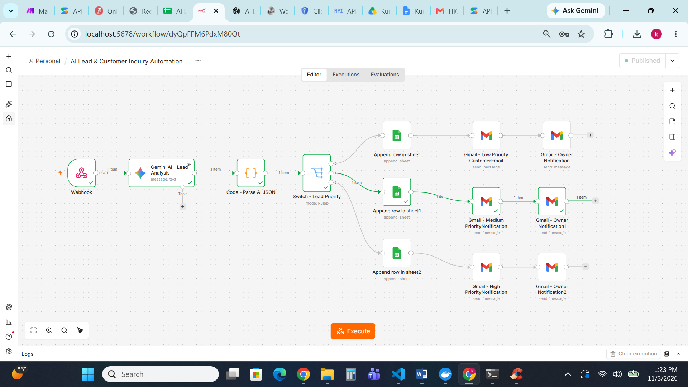
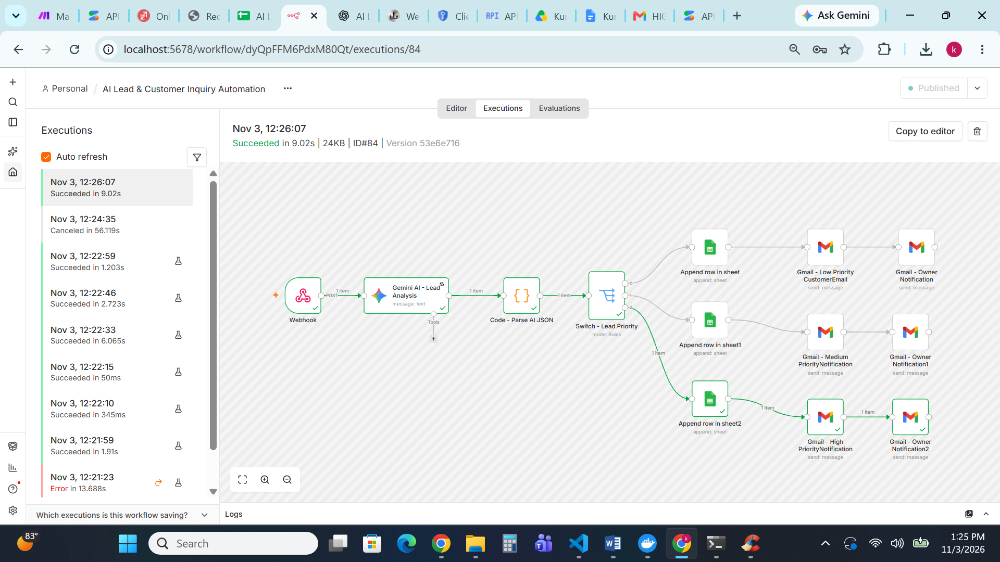
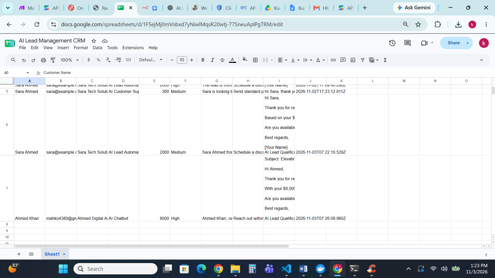
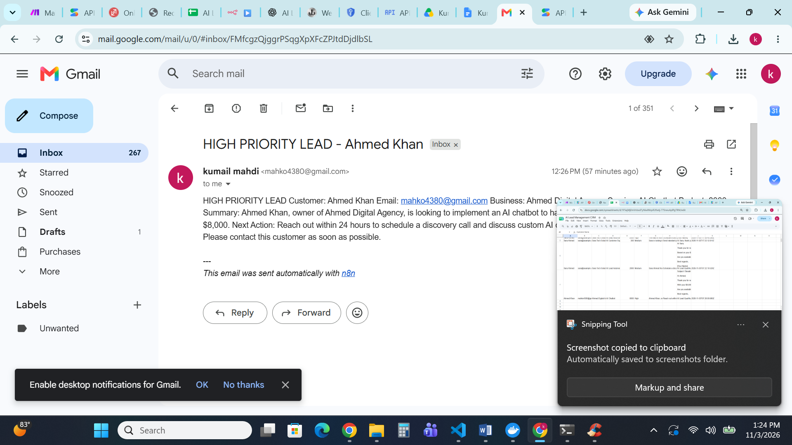

# AI Lead & Customer Inquiry Automation

An AI-powered automation system built with n8n and Google Gemini to analyze customer inquiries, qualify leads, assign priority levels, and manage follow-ups automatically.

## Project Overview

This workflow receives customer inquiries through a webhook, analyzes them using Gemini AI, classifies leads into Low, Medium, and High priority, and stores the results in Google Sheets while sending email notifications through Gmail.

## Key Features

- Automated customer inquiry collection
- AI-powered lead analysis using Google Gemini
- Automatic Low, Medium, and High priority classification
- Customer information extraction
- Automated Google Sheets CRM updates
- Gmail email notifications
- Production webhook integration

## Workflow Architecture

Webhook Trigger → Gemini AI Lead Analysis → JSON Parsing → Priority Routing → Google Sheets CRM → Gmail Notifications

## Technologies Used

- n8n
- Google Gemini AI
- Google Sheets
- Gmail
- REST API
- Webhooks
- JavaScript

## Testing

Successfully tested all three priority routes:

- Low Priority — Successful
- Medium Priority — Successful
- High Priority — Successful

Production webhook test completed successfully.

## Project Purpose

The goal of this project is to help businesses automate lead qualification, organize customer inquiries, reduce manual work, and improve follow-up processes.

**Kumail Mahdi**

- GitHub: https://github.com/kumailmahdi91-rgb
- LinkedIn: https://www.linkedin.com/in/kumail-mahdi/
---
*Built with n8n, Gemini AI, Google Sheets, and Gmail.*
## Project Screenshots

### Complete Workflow

### Successful Execution

### Google Sheets CRM

### Gmail Notification

